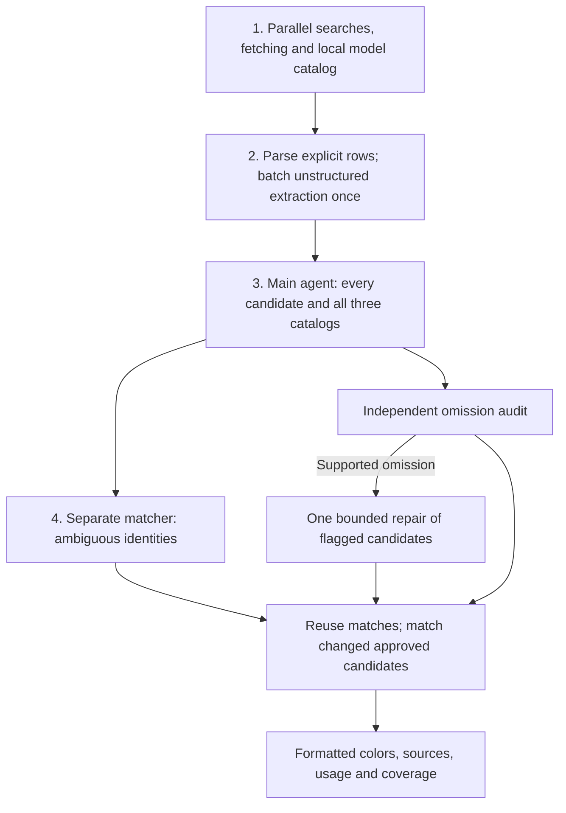

# Automotive paint research

Find source-grounded paint candidates for a vehicle and match their standard/OEM
codes against Lazzumix and BASF. Candidate review and the independent omission
audit remain mandatory; the separate final color review is off by default.
The result is a palette for comparison, not a guarantee of one exact paint match.

`automobileType` guides search terms for cars, motorcycles, trucks, buses,
agricultural equipment and construction equipment. Other type descriptions use
the general vehicle profile; the main reviewer still judges each
candidate from its own model/year evidence. A missing type keeps the car profile
for compatibility. Vehicle type appears in the response when supplied.
Current multi-type validation and remaining release gaps are recorded in
[vehicle-type validation](docs/vehicle-type-validation.md).
The saved six-vehicle non-car live benchmark, including the Marcopolo failure,
is in [non-car live benchmark](docs/non-car-live-2026-10-07.md). Run it later with
`npm --prefix backend_serper_qwen_guarded_recall_relaxed_best run test:non-cars -- --run all` (paid APIs).

This is a relaxed-recall copy of `backend_serper_qwen_guarded_recall`.
The source backend and its databases remain unchanged. Budget target: **$0.07–$0.08
per request including Serper**; processing target: **60 seconds**, with a **100-second hard maximum**.
Admission queue time is additional. These are benchmark targets, not guaranteed service levels.

This copy keeps the main agent, separate code matcher, model routes, mandatory
catalog lookups and the omission audit. It returns the reviewed and matched
palette directly. No final-review model calls, searches, page fetches or reserved
budget slots run by default. Set `verification: true` only to opt into the older
final color review. The shared provider scheduler still caps concurrency across
vehicles.

Historical benchmark notes below describe runs with the earlier final-review
default. They do not measure the current default flow.

The source backend's four-concurrent Brazilian vehicle run (Corolla, Cruze, S10 and Puma)
passed **4/4** with complete candidate and final-color review. Processing times
were 47.9, 60.5, 78.4 and 58.9 seconds respectively. The total AI and Serper
cost upper bound was **$0.148783**. Puma returned one `Vermelho Mont Carlo`
color, with `Vermelho Monte Carlo` kept as its source-backed spelling alias.
The source report is at `tmp/catalog-vehicle-evaluation/suite-1791327164822-a18af98f/summary.json`.
The copy's four-concurrent run passed **3/4** at 64.5, 73.0, 76.3 and 77.5 seconds
for Puma, Corolla, S10 and Cruze, respectively. It found all four required
reference colors and reviewed every candidate and final color, but Cruze remained
partial because the source-backed `Cuarzo Metálico` has an unresolved full paint
name. Its total AI and Serper cost upper bound was **$0.185851**. The copy report is
at `tmp/catalog-vehicle-evaluation/suite-1791328005035-6f5e8d01/summary.json`.
The runs processed different candidate volumes, so their end-to-end times are
not a controlled comparison. A saved 40-color S10 verification replay using the
same input evidence completed in 18.55 seconds in the source backend and 10.04
seconds in this copy, with 40/40 colors reviewed and seven model calls in both.
It used no Serper searches; model costs were $0.003791 and $0.003862. The replay
validates this stage's speed, but the copy has not passed the four-vehicle
acceptance benchmark. These checks establish minimum reference coverage, not
exhaustive palette accuracy or a latency guarantee.

A later scheduling benchmark held the model limit at four and delayed evidence
for the first four of seven final-review groups. Across three paired runs on the
same synthetic 40-color palette, the old slot placement took 930, 904 and 903 ms; placing
the slot around only the model request took 754, 753 and 754 ms. Every run made
seven model calls and reviewed 40/40 colors. One subsequent live S10 run passed
in **53.4 seconds** with 112/112 candidates and 76/76 final colors reviewed,
18 Serper searches, zero failed searches and **$0.04936** total AI plus Serper
cost. This single-worker live result cannot isolate the scheduling gain from
search variation or from the earlier four-worker contention.

The subsequent four-worker run of Corolla, Cruze, S10 and Puma passed **3/4**
again. Processing times were 70.5, 73.0, 72.8 and 69.2 seconds respectively;
the total AI plus Serper cost upper bound was **$0.207975** (reported cost was
incomplete). All four reference paints were present, and all 334 candidates and
140 final colors were reviewed. Corolla remained partial because the source-backed
`Titanium Metallic` candidate had an unresolved full name. The report is at
`tmp/catalog-vehicle-evaluation/suite-1791329066560-16a4deb2/summary.json`.
Compared with the prior four-worker copy run, median processing time fell from
73.0 to 70.5 seconds, but candidate volumes and search results changed; final
verification was faster for Corolla and slower for Cruze and Puma. This is not
evidence of a reliable end-to-end speedup or four-worker production readiness.

The other four built-in cases (ix35, Azera, Gol and Versa) then ran together at
four-worker concurrency and passed **3/4**. Azera, Versa and Gol passed in 38.2,
60.9 and 68.8 seconds; ix35 failed at 56.5 seconds because it returned
`Shimmering Silver`/N3S but omitted the separately required `Hyper Metallic`/WJX.
All 263 candidates and 63 final colors were reviewed. Combined AI plus Serper
cost upper bound was **$0.167000**, with exact cost incomplete for three runs.
The report is at `tmp/catalog-vehicle-evaluation/suite-1791329447297-828913d1/summary.json`.
The acceptance checks also missed an exact duplicate `Dark Charcoal` in Versa
and a catalog-only `Muranorot Perleffekt` in the silver Gol output. Passing
reference checks do not establish full palette precision.

The source selector rejects a different maker sharing the model name and can
fetch one planner-proposed page from a host already found by search. It merges
uncoded one-letter name variants only when source-owned excerpts mention both
complete spellings; similar names alone stay separate. Earlier failures and
optimization checkpoints are in [implementation history](docs/implementation-history.md).
For coded final colors, equivalent terminal Arabic and Roman version numerals
(for example, `Steel Grey 2` and `Steel-Gray-II`) merge only with the same paint
name, compatible finish and a shared OEM code. Other versions remain separate.

The current flow recovers structured paint rows from brochures and catalogs before
AI extraction. The main researcher reviews every candidate; the separate matcher
checks codes, and the omission audit checks excluded candidates. Broad and
specialist searches, catalog crossing, bounded retries, and per-run page reuse remain.
Numbered model color lists from the requested or adjacent year also enter normal
candidate review with their printed year retained. After review and code matching,
a fetched paint row may supply a Portuguese display name when it prints that
name beside the existing complete name and its matched code. The original name
remains an alias, and the row's URL is added as a source. Long owner manuals
without an identifiable paint palette skip model page analysis to preserve the
extraction budget for actual paint sources.

An unresolved foreign display name can use a final text-only lookup when search
slots and time remain. It spends at most two browser searches and 4.5 seconds,
with no additional model calls. A product page may establish a Portuguese alias
for an uncoded paint only when it explicitly links both complete names and prints
one OEM paint code with the foreign name. The alias source is attached to the
color; the lookup does not assign that code or turn maker-wide evidence into
model/year availability. Code assignment remains with the separate matcher.

When broad charts yield many candidates but no requested-year palette,
`palette_gap_research.js` checks indexed paint-name leads and candidates linked
only to weak-year sources. It spends at most two extra searches inside the
20-use browser budget, preferring an accessible year-specific brochure and a
short query for one uncertain name. The brochure query covers the requested
model rather than selecting one trim from search results. `literal_paint_rows.js`
recovers printed code/name rows from brochure tables before the page extractor runs. The existing
main planning call sees unresolved year/name gaps; it does not get a new model
call. Named leads still require ordinary review, catalog matching and final
verification. `Perol` and other recognized finish suffixes move to
`paintFinish` after matching, and same-code versions merge only when their
underlying paint identity agrees.

The source backend's latest live Saveiro 2015 red run took 49.1 seconds, used 16 Serper searches,
fetched 20 pages and reported $0.037442 total AI plus Serper cost. It passed
the built-in reference checks with `Vermelho Flash` and `Vermelho Ópera` among
seven returned colors. The combined-lead query used one search slot for several
previously indexed paint names; no expected paint was inserted into production
searches. `Vermelho Flash` remained a weaker manufacturer-scoped comparison
lead with unknown year and code verification, while `Vermelho Ópera` had
model-year page evidence. Passing reference checks does not establish that all
possible paints were recovered. A direct Gemini comparison is unavailable
because no matching Gemini output or benchmark inputs were saved.
This relaxed copy has not had a paid live run; the source benchmark is a baseline,
not a result for the adjacent-year snippet rule.

A fetched model/year color list can also supply a finish-qualified display label
such as `Vermelho Perolizado` when no distinct marketing paint name is printed.
The result marks it `identityType: vehicle_display_color`; this label is a
comparison option, not a unique paint identity. Bare hue words and general
brand palettes remain insufficient. Explicit other-model and out-of-year
model-history evidence cannot establish a candidate for the requested vehicle.
When all local catalogs lack a code, the separate matcher may keep the same
paint-owned code printed by two independent fetched domains. Such output is
marked `codeOrigin: cross_checked_web`; a single web code remains unknown.

Specialist equipment can publish one fleet-standard paint instead of a model
palette. `source_claim_scope.js` links that named paint only when a fetched
source explicitly states it is standard across the maker's equipment and a
different fetched domain identifies the requested model and period. The main
researcher must still review both claims; an admitted result is marked
`identityType: fleet_standard_paint` and remains a qualified possibility.
The model-context page cannot supply that paint's code. After recovery, two
independent web domains corroborating a sparse specialist palette can satisfy
discovery coverage without an arbitrary three-color minimum. Local catalog
rows alone do not count as two independent web domains.

The final response keeps every reviewed comparison option in `colors`. After
formatting, `applicabilityScope` identifies its strongest model link:
`model_page`, `model_catalog`, `model_display_label`, `fleet_standard`,
`shared_paint_possible`, `adjacent_year_lead`, or `manufacturer_only`.
An adjacent-year lead comes from a structured model palette indexed one year
from the requested year. It stays a low-confidence comparison option until
fetched evidence confirms the requested year. A manufacturer-only or shared-paint
entry is a comparison lead, not a confirmed
color for the requested model. `paletteScope` counts model-linked options and
manufacturer-only leads. If the run found only manufacturer-wide leads,
`completion.issues` includes `no_model_linked_colors`; the leads and their
sources remain visible. Optional final verification fields show which name,
vehicle, year, code and finish facts were confirmed when that stage is enabled.
Related paint thumbnails
on a single-paint page and retailer coating product titles are recorded as
identity artifacts rather than paint names. This scope annotation is applied
programmatically after the agents finish and adds no AI calls or searches.

Historical and small-volume vehicles may have no surviving model/year paint
list. The main reviewer can retain genuinely named manufacturer exterior paints
as low-confidence comparisons when their exact fitment is unknown. A sole
`no_model_linked_colors` limitation still leaves the public completion status
`partial`; the saved vehicle acceptance runner treats it as a processed,
evidence-limited result only if all required candidate, omission and code reviews
completed and the required reference was found. Other incomplete work still
fails. This does not confirm that the paints were offered on that model/year.

If ordinary discovery finds no model-linked named paint, `manufacturer_paint_recovery.js` makes
up to two narrow manufacturer paint searches and fetches at most three matching
product pages. It first checks results already indexed by the original searches.
It uses available slots inside the existing 20-use browser budget
and runs only on this empty-inventory path. A product title must print a complete
manufacturer-qualified shade, such as `Branco Marcopolo II`; coating type,
package size and seller SKU are never paint codes. A page that fails to print
the shade can contribute only a visibly weaker search-snippet lead. These candidates still pass through
the main reviewer, mandatory catalogs and separate code matcher.
They remain `manufacturer_only` comparison leads unless separate evidence links
them to the requested model; the response stays partial when no model-linked
color was found. For a bus, the vehicle's paint project or body identification
is still needed to determine the applied factory paint.

When a fetched source explicitly documents that a maker used another maker's
paints, `shared_paint_research.js` can use up to two remaining browser slots to
look for that donor's paint chart for the requested year and optional hue. It
tries at most two chart pages per donor if the first yields no usable paint,
and keeps at most four named leads per donor with a hue preference or eight
when no predominant color is specified, for normal
catalog lookup, main review and matching. Each accepted
lead cites both the donor chart and the source documenting the sharing practice.
Its `shared_paint_possible` scope means the exact model/year use is still
unconfirmed. A chassis relationship or donor catalog alone does not qualify,
and this path never changes the requested vehicle's manufacturer.

If the completed normal palette is empty and every candidate review and omission
audit has finished, one exceptional fallback selects a paint name already found
in a run source. The normal review, matching, finish filter and formatting rules
finish first; the fallback is returned with its source and uncertainty. Its
`colors[0].isFallback` is `true`,
`applicabilityScope` is `fallback`, and the original source scope remains in
`sourceApplicabilityScope`. `paletteScope.fallbackCandidates` counts these
exceptional options separately. The top-level `fallback` object records why it was
used, the earlier review reason, any confirmed finish exclusion, and whether
its source was fetched or only a search snippet. `completion` remains partial
with `fallback_used`; an unknown
code stays empty. If no source in the run named a paint, or research failed
before reaching the final palette, this named-paint exception cannot run.
Incomplete reviews keep their existing partial result and do not trigger it.

If no named paint survives that last step, `observed_color_fallback.js` may
return one generic hue explicitly printed in a fetched color field for the
requested model. It is labelled `identityType: observed_hue`,
`sourceApplicabilityScope: appearance_only`, and `isFallback: true`, with no
paint code. A different source year is reported in `fallback.sourceYearRelation`.
This is an appearance comparison lead, not a factory paint identity. It uses no
additional searches or model calls. If no fetched model page even states a
color, the response remains an error or empty result rather than inventing one.

Finish-qualified generic display labels use exact-name local lookup across all
three catalogs. They never inherit a code from a nearby catalog name, and the
final matcher skips code assignment for `vehicle_display_color`.

This guarded copy sends unsupported compact hue exclusions back to full review
when a commercial name gives no visual hue. A same-maker, same-code catalog
alias can prompt an independent hue check on an approved color; an alias alone
never silently excludes it. One existing bounded code-clarification search can
also resolve a model-linked ambiguous name when the vehicle year is unspecified.
The model routes and default search quota are unchanged.

## Run

Run commands from the **repository root**. This backend uses the root Node
dependencies and `.env`, Python 3, the root `lazzumix.db` and `basf.db` files, and local `data/basf_models.db`. This copy also declares the installed parse5 8.0.1
HTML parser dependency.
The public-page downloader also declares the installed `undici` and `ipaddr.js`
versions. Application API calls keep their existing transports and routes.
All three catalogs are required; normal lookups use Python's standard SQLite library.

Environment for the default routing:

```dotenv
SERPER_API_KEY=...
OPENAI_API_KEY=...
OPENROUTER_API_KEY=...
# Optional last page-analysis fallback:
GEMINI_API_KEY=...
```

Serper is the default search provider; setting `SERPER_API_KEY` is sufficient.
OpenSERP and its residential proxy are not required for default searches. AI routes
without credentials are skipped; supplying both OpenAI and OpenRouter credentials
enables the full primary/fallback chain.

```bash
# Default: Hyundai Azera 2017, Brazil, white, pearl finish.
node backend_serper_qwen_guarded_recall_relaxed_best/ai.js

# Unrestricted hue and finish: omit those input fields.
node backend_serper_qwen_guarded_recall_relaxed_best/ai.js '{"brand":"Chevrolet","model":"Cruze","manufacturingYear":2018,"country":"Brazil"}'
```

The CLI writes progress events to stderr and one final JSON response to stdout.

### Input and module API

Only `model` is required. Optional fields are `automobileType`, `brand`,
`manufacturingYear`, `predominantColor`, `paintFinish` and `country`.
`paintFinish` accepts Portuguese/English descriptions, such as `perolizado` or
`pearl`. Omitted/empty/unknown values leave the finish unrestricted.
Use a specific type such as `motorcycle`, `truck`, `bus`, `tractor` or
`excavator` when known. An unfamiliar type remains valid and searchable.

```js
const { AgenticLoop } = require('./backend_serper_qwen_guarded_recall_relaxed_best/ai');

async function researchVehicle() {
  const agent = new AgenticLoop({
    onProgress: event => console.error(event),
  });

  return agent.loop({
    automobileType: 'car',
    brand: 'Hyundai',
    model: 'Azera',
    manufacturingYear: 2017,
    predominantColor: 'branco',
    paintFinish: 'perolizado',
    country: 'Brazil',
  });
}
```

Create a **new `AgenticLoop` per vehicle**. Its returned response includes
candidate review, omission audit, code matching and source scope. Set
`verification: true` to add the legacy final color review and use the optional
`onInitialResponse` snapshot callback.
Reusing an instance rejects with `code: 'AGENT_ALREADY_USED'` before touching
the original request's resources. Progress callbacks may be asynchronous; their
failures are isolated and they are never awaited by the research pipeline.

## Architecture

### BASF model evidence

`data/basf_models.db` contains **96,657 rows from 210 Feather files** in root
`extracted_data_models/`, covering 4,053 normalized manufacturer/model pairs.
Each row retains its description, manufacturer, model, safe standard/OEM code,
original catalog year, parsed bounds and source-file/row provenance. Only allowed
fields are imported; `Std`, `Std. No.`, `Aux Code` and `Color Finder` are excluded.
64 unsafe supplier references were withheld from the code field without losing
their paint/model records. `Color Class` was empty and is not used as finish proof.

Model lookup runs locally alongside the unchanged seed searches. Manufacturer
aliases and punctuation are normalized; model tokens prevent substring matches
such as Gol/Golf or S10/S100. Trim/generation-qualified model labels stay explicit.
Generic hue labels are not new named paints. Descriptions composed only of documented OEM-code combinations do not become
named candidates; their separately named component records remain eligible. All
named model records remain available for normal agent review; hue words in a commercial name cannot
programmatically discard a record.
All model rows remain available in `model-catalog.json` and candidate lookups.

Every web or local candidate is checked against all three catalogs. New source-linked
codes refresh a cached lookup; repeated sightings without new codes reuse it. Exact local
record identities can avoid redundant paid identity/matching calls. The main
researcher still decides each candidate, and the final verifier checks every
output color with web and catalog evidence. Model rows are rendered as labelled
local evidence, never counted as HTTP fetches or presented as website URLs.
They may appear without an online source; the final response then retains a
`catalogSources` record ID. An online source is preferred when available.
Catalog finish variants with the same OEM code, manufacturer and base shade
are consolidated with their published aliases and standardized finish fields.
Different shades can still legitimately share a code.
Finish display also reads brochure tables that put a standalone finish label
in the cell immediately after a complete paint name; it does not use the
requested finish as evidence.

No market column exists in this export. Model associations can support a possible
paint, but catalog years do not independently confirm an exact model year or
Brazilian availability. Unknowns and missing records never justify exclusion.
The export includes Azera, ix35 and Gol, but lacks Chevrolet model coverage;
the older catalogs and international/local web research remain necessary.

The response goal is **60 seconds**, with a **100-second hard maximum**. Fixed
wall-clock cutoffs stop discovery at 17 s, first review at 60 s, completion
repair at 68 s and matching/omission audit at 82 s. The remaining time is for
output and cleanup. The optional final verifier has later cutoffs at 88 and 98 s.
Caller cancellation still aborts the run. Cutoffs include capacity waits and
cannot be extended by fallback attempts.
Provider failures or saturation can produce explicitly incomplete results; the
deadline does not guarantee complete research under arbitrary load. The $0.06
AI target and search cap remain unchanged.

### Pipeline

`ai.js` owns the lifecycle. Network calls overlap within collection; later stages
receive a stable evidence inventory. Detailed work belongs to three stage modules:
`discovery_pipeline.js`, `review_stage.js`, and `omission_review.js`.
`settled_review_work.js` sends already completed candidate decisions to matching
and omission auditing while other reviews finish. This overlap begins only after
discovery has sealed the inventory. Matching retains its own agent and cache;
unchanged identities and already audited exclusions are not sent twice.



The repair arrow is bounded: it never starts another omission-audit loop.
Matching and omission auditing overlap with remaining candidate reviews under
the existing shared API limits. All audits join before formatting; repaired
approvals receive matching.

### Flow in five stages

1. **Collect broadly.** Start Brazilian, international and specialist palette
   searches programmatically, alongside the BASF model catalog. Source selection
   balances query coverage, independent domains and the requested year. Earlier
   pages may start extracting while searches finish. At most half the initial
   slots are filled from streamed results; the rest are ranked after all seed
   queries finish, so the first result cannot exhaust the page allowance.
   Start the reserved Portuguese-name query while seed pages are being analyzed,
   so a slow extractor cannot exhaust its search window. Reserve up to four page
   slots for late sources. Paginated results also admit their first page.
   Coverage gaps or several ambiguous names may trigger one main-agent planning
   call; a populated single source is insufficient. Retain one Portuguese-name
   query and one bounded name-clarification wave. The planner selects useful name
   searches instead of filling every slot. Its name-search allowance is separate
   from general searches. Unselected candidates still receive main review.
   Serper publishes each completed query immediately. Coverage planning waits
   for outstanding searches, while page fetching already runs. Up to two normal
   search slots (within the existing quota) are held for one recovery wave.
   A final recovery wave can replace failed pages with up to eight unattempted results
   when independent paint coverage remains insufficient. Adequate coverage means
   at least three source domains, two domains containing named palettes, and three
   candidates. After that, the Portuguese query can add up to two targeted pages;
   arbitrary extra charts are not fetched just to fill a download quota.
   Sparse coverage also admits manufacturer paint catalogs;
   this supplies evidence for donor paints without assuming donor applicability.
   Successful-page limits remain in force and exhausted credits stop recovery.
   A reader response that embeds a target-site HTTP error is recorded as a
   failed fetch, even if the reader itself returned HTTP 200. When that page
   cannot be read, a structured vehicle-specific palette in its search snippet
   can provide bounded low-confidence names for the normal review and optional
   final verification. A structured palette indexed one year away may also supply
   a weak name lead. An isolated nearby-year product title cannot. Snippets
   do not count as fetched pages or confirm names, codes, finish, fitment or
   the requested year on its own.
2. **Extract once.** Recover explicit paint rows and labelled product cards
   deterministically, retaining fitment qualifiers and conflicting swatch text.
   Repeated two-line name/code swatches also qualify when the page explicitly
   introduces paint codes and swatches and at least three pairs agree with that
   structure. Unparsed prose and qualifiers still reach extraction/review.
   Codes belong to the named row/card; nearby paints and page-opening text cannot
   contribute unrelated code hints. When an
   entire page consists of recognized rows and headings, no extraction call is
   needed. Otherwise Qwen reads the unparsed content in batches, with source
   context retained. Exact repeated documents share extraction within the run.
   Failed segments alone receive recovery; successful pages get no repeated
   full-page audit. Names and exact source passages enter a shared inventory.
3. **Review a stable inventory.** Every candidate queries Lazzumix, BASF and BASF
   models. The main researcher assesses applicability, complete name, hue,
   finish and catalog identity together. Compact exclusions are final decisions;
   likely/uncertain requested-family candidates use full decisions. Candidates with
   apparently conflicting hue words use a compact evidence check: supported
   exclusion or `review`. A name word alone cannot justify exclusion; every
   uncertain case enters full first-pass review under the same stage deadline.
   This routing step does not consume its single correction allowance. Queued items
   assemble into batches when capacity becomes available, avoiding tiny frozen
   requests. Specific ambiguity can trigger one
   extractor question. Invalid/failed decisions and explicit hue conflicts get
   bounded repair. Successful decisions are retained; no speculative early
   reviews or code matches run while sources are still changing.
   Catalog-only aliases may share a review only with the same manufacturer, one
   exact standard code, identical model/year scope and the same known finish.
   Web aliases additionally require a shared verbatim passage printing both full
   names and the code, identical web evidence, and matching explicit model scope.
   Ambiguous or conflicting candidates stay independent. Each
   original candidate retains its own catalog lookups, decision and source IDs.
   A review labelled `unrelated_hue` cannot discard a published requested-hue
   candidate solely for uncertain model/year scope. Such a candidate remains a
   low-confidence comparison lead unless evidence establishes a different
   visual family or an explicit exclusive year range.
4. **Match settled approvals.** The separate matcher receives buffered approved
   candidates while unrelated reviews continue. The final join reuses unchanged
   matches; only changed or newly approved identities need matching. Fresh
   lookup results can reuse source-code identities or a reviewed exact complete
   name with one unambiguous same-manufacturer code. Conflicting codes and aliases
   still require the matcher. Failed matching is tracked separately from a genuine
   no-match and retried once per unchanged input; successful siblings are reused.
   An exact complete catalog name with one same-manufacturer code can also be
   reconciled locally when the web page prints no code. Conflicting source codes,
   incomplete names and ambiguous identities require the matcher. Exact-name
   alternatives are never hidden by the fuzzy catalog retrieval limit.
   One run-local transport queue combines up to eight inputs within its evidence
   size limit and admits at most three matching calls at once. Indices are restored
   for each caller; sources never cross candidate boundaries. Empty catalog
   candidate lists resolve locally without an AI call. Invalid or foreign row IDs
   trigger a fallback, rather than silently becoming an empty successful match.
5. **Audit omissions and repair.** Alongside remaining reviews and matching,
   the independent omission audit checks discarded/unresolved leads for overlooked support. A reconsideration
   identifies the disputed fact and cites that candidate's own evidence. General
   model applicability cannot overturn a hue decision. Unsupported flags remain
   visible in omission diagnostics without triggering paid repairs. Supported
   flagged candidates return to the main reviewer, and only changed approved
   results need matching. The reviewed and matched palette is then formatted.
   The optional final verifier can check each output color after formatting
   when explicitly enabled.
   Buffered omission audits cover each excluded/unresolved candidate once. Their
   budget stays protected until every batch joins. A failed batch preserves
   successful siblings and reports its incomplete coverage.
   A protected repair allowance funds one final attempt for unfinished reviews.
   The completion queue owns invalid/missing full decisions. It starts as
   individual batches settle, overlapping independent
   first-pass work. There is no additional stage retry or automatic child-repair
   loop. Valid siblings remain settled, including completed streamed members
   recovered on parent cancellation. The shared abort reason is never mutated.
   Budget failures retry only when completion funds can actually admit them.
   A programmatic completion check restores approved paints accidentally lost
   during matching, preserving unknown codes. Recorded finish exclusions remain
   excluded. Unresolved codes and inadequate discovery are reported explicitly;
   neither is silently counted as complete processing.

Finish filtering removes only confirmed mismatches. Names, finish fields and
output compacting remain programmatic. The optional initial-response callback
runs only when the final verifier is explicitly enabled.

Failures produce warnings, partial results or a structured error. Caller
cancellation, network timeouts, quotas and the shared AI budget still apply.
A completed review is not proof that every fact is known or every possible color
was discovered. Candidate and omission-audit coverage remain separate.

### Where requests are saved

- HTML text uses parse5 directly instead of constructing a jsdom browser window;
  swatches, tables, product JSON and continuation links follow the same rules.
- Discovery and name clarification share one page pool; optional final verification reuses it.
  Pending downloads and completed full text are reused; prefetching alone never
  triggers extraction, catalog candidates or model calls.
- Extractors read unparsed source text and avoid emitting clearly unrelated visual hues
  only when the candidate's own descriptions or explicit hue category establish
  the mismatch. Commercial names alone cannot establish that mismatch. Unclear
  or contradictory appearance and mixed target shades survive;
  finish decisions remain with the main reviewer. This reduces irrelevant
  candidate reviews without imposing a candidate-count cap.
- Small page extracts share a request (up to three, 18,000 input characters).
  Dense paint tables also split at 96 source units, with bounded overlap and heading context;
  navigation-heavy pages retain the character limit.
  Larger segments run separately. All source text is retained; citations remain
  page-local. Usage and HTTP attempts are recorded once for each shared request.
- A name-clarification page sends no model request when its full text contains
  neither a usable name fragment nor any supplied paint code. Short initials and
  uncertain matches still go to the extractor. Long clarification documents send
  only segments containing those fragments or codes; general research still
  analyzes every segment. The complete fetched text remains available for review
  and the page remains visible in retrieval accounting. `page_analysis_skipped`
  and `page_analysis_scoped` explain skipped pages or segments.
- Exact numbered extraction sections share results within a vehicle run, even
  across pages. Only explicit navigation links are removed before segmentation.
  The key includes vehicle, section text and repeated source context. Changed
  model/year/finish text prevents reuse. Citation IDs are restored against the
  receiving page and checked against its original text. Failed sections are not
  cached. `page_section_reused` reports actual hits; each URL retains its evidence.
- Catalog lookups still query all three databases for every candidate. Identity
  selection joins the main review instead of requiring its own paid call.
  Identical catalog editions share a row with all original year strings retained.
- The search planner receives every candidate's name, aliases, codes and source
  references without repeating full review evidence. Reviewers retain that full
  evidence. Planning cannot approve or exclude a paint.
- Candidate decisions use compact batches with shared verbatim passages and page
  context (up to sixteen candidates and 65,000 workload characters for full decisions;
  up to thirty-two and 85,000 for compact checks of apparent hue conflicts). Sizing includes
  instructions, the provider schema and an output allowance. Evidence is split
  across batches, never truncated to meet those limits. An indivisible candidate
  keeps all its evidence even if it alone exceeds the batch target. Catalog rows also
  share a column-based table; each candidate has its own allowed short references, which
  code restores to the original database IDs. The application expands compact
  decisions before existing validators.
  A partly valid batch preserves valid decisions and repairs only the malformed
  or semantically invalid children. Every child must pass its own schema and
  evidence checks before approval; other model requests remain strictly validated.
  Candidates with apparently unrelated hues return a short supported exclusion
  or `review`; every uncertainty receives full review. The input still includes
  each candidate's complete source evidence and all three catalog lookups.
  The full-review repair queue batches uncertain/invalid children together;
  successful siblings are not repeated. Batches wait for available transport
  slots before choosing their members. The stable candidate inventory queues
  together by default: a slow early decision cannot starve later batches through
  a second candidate-admission gate. All transport queues share the account scheduler and its completion headroom.
  Model/fallback order is unchanged. A timed-out main-review batch retains
  schema- and evidence-validated children; unfinished work enters the one
  completion queue. Optional final verification retains its separate bounded split recovery.
- When enabled, final verification searches group up to three paints, preferring shared codes.
  At most six primary searches and two individual identity fallbacks are allowed,
  within the run-wide cap. An unknown finish does not automatically create more
  searches. Every color receives its own checks,
  with up to three colors reviewed in one request. Numbered evidence IDs replace
  generated quotations; exact source text is restored and checked in code. New
  fetched evidence is included.
- Budget admission precedes capacity reservation. Unsent requests return their
  token/request reservations instead of exhausting the local scheduler.
- The shared AI target protects 40% for candidate reviews while earlier stages
  and code matching overlap. Only explicit final-review opt-in reserves 20% for it.
  After the first review wave, confirmed exclusions reduce the verification
  workload forecast; every unresolved lead still counts as a possible final
  color. The allowance is $0.001 plus $0.00015 per possible color, bounded by
  5–20% of the AI target. This heuristic releases unused funds without raising
  the overall target. Unspent review protection is released after reviews settle.
  Failed candidate reviews get one overlapping completion wave: up to twelve full decisions
  per transport batch, or twenty-four for apparent hue conflicts. Both preserve
  uncertain inclusions and require each candidate's own evidence. Successful decisions are retained.
  Exhausted providers/budgets still report actual incomplete coverage.

The independent omission audit has its own one-correction ledger. A prior
response-format repair cannot block a newly supported factual dispute. Audit
corrections receive the exact candidate-owned passages and all original catalog
choices; they cannot start another audit or recursively retry.
Waiting audit candidates are grouped only when one of the two transport slots
opens. Repairs release their audit slot, and the final join includes newly
admitted batches before releasing protected audit funds.

Portuguese output names can also come from Lazzumix when the full normalized
vocabulary, manufacturer, common matched OEM code and finish evidence agree.
This uses a real catalog label, retains the international name in `aliases`,
and records the Lazzumix row in `catalogSources`. The final verifier receives
that row. Shared codes alone, different versions and incompatible finishes
cannot produce a localized name.

Repeated color-gallery headings and exact name/year captions can be extracted
locally through `gallery_paint_rows.js`. Their full sections and qualifications
remain evidence for normal catalog lookup, main review and final verification.
Unknown structures still go to the extractor. This is not an availability or
finish shortcut. A saved S10 gallery yielded the same 56 names with 3,646
residual characters instead of 18,932; that isolated measurement is not a
full-run timing guarantee.

Optional transport controls: `batchReviews: false` or
`pageAnalysis: { batchPages: false }`. The staged lifecycle does not schedule
legacy early reviews or full-page audits.
The default main page allowance is 24, plus name clarification;
`maxPageFetches: 35` restores the original allowance. Initial source collection
remains broad. Late replacements repair insufficient independent paint coverage;
they do not fill a fixed number of successful downloads. Search allowances are ten
main queries plus six name-clarification queries; `maxSearches: 14` restores the
original main allowance. No cross-run result cache was added. Timed-out provider requests may have
unreported charges; the reported estimate does not claim those attempts were free.

### Page reuse and prefetching

As search results arrive, normal source selection starts required reads. The
remaining relevant results are ranked using model/year context, query coverage
and domain diversity. Up to two additional URLs per search callback can enter a
four-page unused buffer, with at most eight speculative admissions per run.
These admissions do not consume the existing extraction allowance.

`page_pool.js` stores a promise immediately for each normalized URL, then retains
the fetched full text/status. Tracking parameters and fragments are removed using
the existing source normalizer; meaningful query parameters and pagination remain
distinct. A later consumer joins pending work or reuses completed content. Text
reuse never reuses a model decision across changed vehicle/paint context.

All pooled downloads share `fetchConcurrency`; at most two speculative downloads
are active, leaving a slot for demanded work even with a smaller configured pool.
With concurrency one, speculative prefetching is disabled. Demanded jobs take
queue priority, including in the existing shared network scheduler. There is no
separate fetch capacity allowance for verification. Already-running requests are
not duplicated or restarted merely because a consumer arrives.

Prefetch admission stops at the fetch-stage target. At discovery completion,
unused queued/running work is cancelled; completed text remains available for
name clarification or optional verification. Normal research can still request missing pages.
Each attempt keeps the five-second bound. A later consumer may retry a transient
failure/cancelled fetch once; permanent errors and empty pages are retained.
No cross-request or persistent cache is introduced.

Speculative pages are reported even if never selected for extraction. They are
not added automatically to the candidate inventory or sent to a model. This can
save later waits but cannot remove model timeouts or guarantee a faster run.
`maxPrefetchPages: 0` disables speculative work while keeping shared page reuse.

### Grouped searches

`search_groups.js` builds quoted OR alternatives programmatically. No AI call is
needed to plan the grouping. Initial Brazilian, international and specialist
palette searches, plus broad sparse/donor discovery, remain independent.

- **Name clarification:** pairs of selected leads share a query when the existing
  name-search quota can also fund an individual fallback for every member.
  Otherwise they retain individual queries. Shared pages are extracted against
  an explicit list of leads; every name retains its own codes and source evidence.
  An unresolved abbreviated name gets its original individual query. Only actual
  extracted complete names count as coverage, not snippets or database hints.
- **Portuguese names:** a known international name or a source-linked standard
  code can locate local descriptions in one query. No Portuguese translation is
  invented and the main reviewer still checks the identity.
- **Finish, local-name and donor follow-ups:** `followup_search.js` may combine
  two explicit questions about the same named candidate. Their full query scopes
  remain in separate OR branches. It checks extracted passages for each question,
  then uses individual queries for missing evidence. Grouping requires spare
  quota for the worst-case fallbacks; normal/recovery reservations stay in force.
  Arbitrary planner queries and different paints are not merged by this helper.
  Donor makes are never inferred or hardcoded; brand-sharing claims remain agent
  decisions grounded in the vehicle/paint evidence.
- **Optional verification:** existing evidence from two independent domains can avoid a
  redundant search when it identifies that paint. Every color still receives the
  final web/catalog model review; unknown/conflicting finishes remain explicit.
  Missing identity evidence goes to small grouped queries, then at most two
  individual fallbacks across the entire verification stage. One paint cannot
  receive repeated fallbacks. Exact queries and per-name research are reused
  within the run. Changed codes/finish metadata update the review context without
  repeating research. Up to twelve new page admissions are allowed; unrelated
  search hits are rejected before download. Existing pages can still be reused.

`search_budget.js` reserves slots synchronously before logical searches start;
each HTTP retry needs another slot before sending. All providers and stages
share the same instance. The default flow reserves no searches for final review;
opting into it reserves four slots at the default limit. Denied work never
reaches the search provider or Serper billing tracker. The limit applies per
vehicle run, not across separate customers. Page downloads and AI calls have
their own limits and do not count as search requests.

Once a search budget is exhausted, the agents complete their mandatory reviews
using collected web/catalog evidence. Unknown facts remain unknown; budget
exhaustion neither approves a paint nor removes it as a finish mismatch.

Finish alternatives are search vocabulary, not equivalent finish classifications.
Metallic, pearl and tricoat keep their existing distinct review rules. Grouping
never merges colors or lets one paint's evidence confirm another. Queries that
grow too long are split, and unresolved facts remain explicit for agent review.
`grouped_search_coverage` events show per-name/per-question outcomes. Search
counts and Serper cost still report actual searches and HTTP attempts; no
theoretical savings are reported as measured savings. Difficult searches may use
their reserved fallbacks, but browser uses and actual search HTTP attempts cannot
exceed 20 in the standard agent flow.

### Evidence rules to preserve

- Commercial names are search clues, not measurements of visual color. This
  applies to every hue family, including names containing ordinary hue words.
  Use the paint's own descriptions, documented undertones and explicit hue
  categories. Unknown or conflicting appearance remains eligible for comparison.
  Silver/prata and gray/grey/cinza/gris share one comparison family in either
  direction. Similar appearance does not justify merging names, codes or finishes.
  Literal code/name and explicit name/year list recovery and model-catalog seeding never remove a named paint based
  only on hue words. Name-based priorities merely order model review work.
- Every named candidate must query **all three catalogs**, even when none matches.
- BASF model records corroborate model applicability. Catalog years corroborate
  paint identity/availability; they do not establish that a
  paint belongs to a particular model year.
- Finish filtering removes **only confidently incompatible** candidates. Unknown
  or conflicting finishes remain eligible. A missing suffix does not mean solid.
- Recognized catalog suffixes provide finish evidence after identity matching.
  Metallic, pearl and tricoat are not interchangeable; surface sheen is separate.
- Cross-brand paint reuse requires evidence linking the individual paint to the
  vehicle or documented model range. A donor platform does not authorize a palette.
- BASF supplier/formula identifiers must not reach model inputs. The importer
  allowlists fields and filters unsafe codes; models receive standard/OEM codes.
- Formatting follows research/matching. Detailed evidence remains available to
  reviewers; the optional final verifier receives formatted colors plus supporting data.
- An optional completed verification review does not mean every fact was confirmed.

## Module map

| Area | Main files | Responsibility |
| --- | --- | --- |
| Entry and orchestration | [`ai.js`](ai.js), `agentic_loop_helpers.js` | Run lifecycle, input validation, state and callbacks |
| Structured model requests | [`research_model.js`](research_model.js), `review_batcher.js`, `request_envelope.js` | Full-request sizing, request envelopes, schema output, usage and stage diagnostics |
| Discovery | `discovery_pipeline.js`, `palette_gap_research.js`, `research_plan.js`, `vehicle_profiles.js`, `search_groups.js`, `followup_search.js`, `search_provider.js`, `browse.js` | Queries, type vocabulary, year-palette gap checks, conservative OR grouping, source-based coverage, source selection and Serper search |
| Shared paints | `shared_paint_research.js`, `source_claim_scope.js` | Bounded donor-year research when a fetched source explicitly documents paint sharing; label donor shades as possible, not confirmed fitment |
| Search reliability | `search_request.js`, `search_urls.js`, `search_errors.js`, `search_usage.js` | Request sharing, retries, URL resolution, failures and counts |
| Search budget | `search_budget.js` | Per-run hard cap across providers/stages/retries; reserve only for optional verification |
| Fetch and extract | `page_pool.js`, `fetch_pages.js`, `public_page_request.js`, `page_response.js`, `html_text.js`, `page_analysis.js`, `structured_extraction.js`, `page_batcher.js`, `page_evidence.js` | Shared downloads, public destination checks, bounded responses/prefetching, page text and extraction scheduling |
| Literal gallery rows | `gallery_paint_rows.js` | Repeated name/year captions with full original qualifications; residual prose still goes to extraction |
| Extraction prompts | `gemini_page_color_agent/` | Extraction implementation, prompts and schemas; directory name is historical |
| Candidate evidence | `candidate_inventory.js`, `source_claim_scope.js`, `display_color.js`, `candidate_year_scope.js`, `source_year.js`, `paint_evidence.js`, `review_input.js` | Candidate aggregation, guarded fleet-standard bridge, qualified display labels, year scope and citation inputs |
| Catalog research | `catalog_research.js`, `catalog_lookup.py` | Per-run SQLite worker, three-catalog lookup and identity checks |
| Model catalog | `model_catalog.py`, `model_evidence.js`, `import_basf_models.py` | Indexed model palettes, explicit local evidence and safe import |
| Candidate review | `review_stage.js`, [`candidate_review.js`](candidate_review.js), `candidate_review_pipeline.js`, `review_groups.js`, `targeted_extractor.js`, `hue_review.js` | Stable-inventory decisions, proven catalog aliases, bounded repairs and extractor follow-up |
| Completion coverage | `completion_review.js` | Final repair of unfinished decisions, lost approved colors and explicit code/coverage gaps |
| Settled review overlap | `settled_review_work.js` | Buffered matching and omission audits for completed candidate decisions; final join and coverage aggregation |
| Final code matching | [`research_code_matching.js`](research_code_matching.js), `code_match_pipeline.js`, `matcher_batcher.js`, `database_code_agent.js` | Catalog evidence reuse, run-local matcher transport, coverage and accounting |
| Finish rules | `paint_finish.js`, `lazzumix_finish.js`, `paint_finish_output.js` | Finish evidence, compatibility and standardized output |
| Names | `paint_name.js`, `paint_duplicates.js`, `name_research.js`, `portuguese_names.js`, `portuguese_name_research.js` | Name completeness, bounded Portuguese alias lookup and equivalent-color merging |
| Omission audit | `omission_review.js`, `settled_review_work.js` | Independent checks for overlooked candidates and one bounded repair wave |
| Optional final verification | `final_verification_agent.js`, `verification_request.js`, `verification_research.js`, `verification_evidence.js` | Additional per-color checks only when `verification: true` |
| Output and reporting | `final_output.js`, `result_completion.js`, [`research_reporting.js`](research_reporting.js) | Output formats, explicit workflow completion, per-model usage and retrieval counters |
| Routing and capacity | `model_router.js`, `model_stream.js`, `model_scheduler.js`, `capacity_server.js`, `capacity_client.js`, `capacity_context.js` | Provider fallbacks, fair admission and shared process/account capacity |
| Vehicle admission | `run_admission.js` | Production overload rejection before paid work, shared across the coordinator's clients |
| Time and cost | `run_timing.js`, `research_deadlines.js`, `ai_budget.js`, `ai_cost.js`, `serper_cost.js` | Stage abort signals, reservations and AI/search cost estimates |

The extracted request, review, matching and reporting helpers receive the current
run explicitly. `AgenticLoop` retains its methods as delegation points, including
existing injection/override hooks. Prompt files remain in their original locations.

### Model order

`model_router.js` is the source of truth for routes, availability and timeouts.

| Work | First route | Remaining routes |
| --- | --- | --- |
| Planning, recovery, final code matcher | OpenAI GPT-6 Luna (standard tier for the matcher) | OpenRouter GPT-6 Luna → OpenAI GPT-5.6 Luna → OpenRouter GPT-5.6 Luna |
| Page extraction | OpenRouter Qwen 3.5 Flash | All four GPT routes above → Google Gemini 3.5 Flash Lite |
| Candidate review with catalog identity | OpenRouter Qwen 3.5 Flash | OpenAI GPT-6 Luna (standard tier) → OpenRouter GPT-6 Luna → OpenAI GPT-5.6 Luna → OpenRouter GPT-5.6 Luna |
| Targeted extraction and optional final verification | OpenRouter Qwen 3.5 Flash | All four GPT routes above |

`modelRouting.candidateReviewQwen: false` opts into GPT-first candidate reviews. Gemini is only the last page-analysis fallback. Routing validates
structured responses and uses the shared scheduler, available budget and stage
signal before accepting or falling back from a route.
Model attempts use workload-based absolute limits plus separate first-content and
idle limits. Useful streamed output refreshes only the idle timer. Provider
keepalives, whitespace and role-only events cannot extend it. See the timeout
table below; explicit environment/routing limits still take priority. Gemini's
last page fallback remains a bounded non-streaming request.

### Shared capacity across worker processes

For multiple Node workers, start **one coordinator for the API account** and point
all workers at its Unix socket. The coordinator loads the root `.env`; do not
launch a separate coordinator per worker. It receives admission metadata and
usage/rate headers, never API keys, prompts or source documents.

```bash
# Terminal 1: coordinator (same host as the workers).
CAPACITY_SOCKET=/tmp/paint-capacity.sock node backend_serper_qwen_guarded_recall_relaxed_best/capacity_server.js

# Terminal 2, and every other worker process:
NODE_ENV=production CAPACITY_SOCKET=/tmp/paint-capacity.sock node backend_serper_qwen_guarded_recall_relaxed_best/ai.js
```

Production mode admits **one active vehicle per coordinator** by default.
Set `RESEARCH_RUN_CONCURRENCY` on the coordinator to change that ceiling only
after measuring the account's capacity. Excess vehicles return
`RUN_CAPACITY_BUSY` with `retryable: true` before paid work begins. Admission
waits at most 100 ms by default; module option `admissionTimeoutMs` accepts
1–1000 ms. The future API should translate this into bounded backpressure.
Seven simultaneous requests therefore mean one admitted run and six retryable
rejections, not seven completed palettes within 50 seconds.

`NODE_ENV=production` (or module option `production: true`) requires the shared
socket or an explicitly injected shared scheduler; otherwise it returns
`PRODUCTION_CAPACITY_REQUIRED`. Development mode retains the existing behavior.
Admission is held through cancellation/cleanup and released afterward. Model
and network quotas still apply inside an admitted vehicle.

Without `CAPACITY_SOCKET`, the existing single-process shared scheduler is used.
With it configured, unavailable coordination produces an explicit error; there is
no independent local-capacity fallback. Use service supervision for the coordinator.
An occupied/stale socket path is not automatically deleted. Before restarting,
ensure its previous owner has stopped and outstanding provider work has settled.
This implementation coordinates processes **on one host**, not independent hosts.

Search HTTP attempts, page downloads and each model pool have separate ceilings:
`SEARCH_CONCURRENCY=8`, `SEARCH_RPM=600`, `PAGE_FETCH_CONCURRENCY=40`, plus the
existing model TPM/RPM/concurrency variables. These are local ceilings, not claims
about the provider's plan. Provider rate headers can lower them. Search retries
also acquire capacity and respect shared cooldowns. Five-second page budgets
start after admission. Queue time remains part of total response latency.

`PAGE_DOMAIN_CONCURRENCY=2` caps concurrent page jobs for each hostname across
workers using the coordinator. Reader fallback has its own shared pool:
`PAGE_READER_CONCURRENCY=3`, `PAGE_READER_RPM=30`. Provider `Retry-After` responses
apply to that pool. Reader admission and its request must fit inside the page's
five-second budget; changing these limits is not a guarantee against site blocking.

Source-page requests allow public HTTP(S) destinations only. The downloader
rejects credentials in URLs, private/local/reserved IP addresses (including DNS
answers), and checks each redirect, up to five hops. DNS validation occurs in the
socket lookup to prevent a separate validation/connection rebinding gap. This
guard applies to the default page transport; injected fetch implementations are
trusted integration code and must enforce equivalent controls.

Direct and reader responses are limited to **10 MiB of decoded body bytes**;
`fetchPages` accepts `maxResponseBytes` for an explicit alternate bound. Exceeding
it returns `PAGE_TOO_LARGE`, never a truncated source. Invalid destinations return
`PAGE_DESTINATION_BLOCKED` without reader fallback. Request/body promises are
cancelled at the page deadline even if an injected adapter ignores its signal.
PDF parsing has an asynchronous deadline, but this does not isolate CPU execution;
production resource limits and network egress controls remain deployment work.

Full and hue-triage review batches share six ordinary transport slots per run by
default, derived from Qwen/global concurrency settings. Slots are acquired before
forming a batch, so pending candidates stay together. Repairs retain completion
headroom. Catalog columns are shared without shortening any source passage.
An actively generating stream reaching its absolute cap no longer cools down
the model for unrelated work; stalled streams still trigger cooldown/fallback.

The AI target also protects completion work: default allowances are 40% for
candidate review, 6% for code matching, 6% for completion repairs and 10% for
the independent omission audit. An explicit final-review opt-in reserves up to
20% for that stage. These protect remaining funds from other
stages; they are not additive spending authorizations. Extraction keeps its 40%
ceiling but cannot spend protected downstream funds. Completed stages release
unused allowances. Optional depth expansion stops when that allowance is low;
mandatory work may still report incomplete coverage if the budget is exhausted.

`MODEL_CONCURRENCY=16` bounds simultaneous model HTTP calls across providers and
stages. `MODEL_COMPLETION_SLOTS=4` keeps four slots unavailable to ordinary
extraction/catalog/review work so matching and repairs can proceed.
These are scheduler/coordinator limits shared across runs, not per-batcher gates;
network pools stay separate. `QWEN_PAGE_CONCURRENCY` now defaults to 8.

Qwen reserves two of its configured slots and up to 100,000 tokens/minute for
non-extraction work (`QWEN_RESERVED_TOKENS` overrides the token reserve). Fair
scheduling rotates vehicle IDs within priority; aging prevents lower-priority
work from starving. Requests wait at most 120 seconds in the capacity queue.
Disconnected workers retain unknown-use reservations for a 60-second lease;
unsent cancelled requests return their reservations immediately. Reported AI costs
still cannot account precisely for provider usage missing after failed calls.

A coordinator cannot create account capacity. If sustained demand exceeds the
configured model/search allowance, queue times rise. Separate runners share those
limits instead of each starting with a fresh token allowance.

## Configuration

Common `AgenticLoop` options:

| Option | Default | Meaning |
| --- | --- | --- |
| `targetTimeMs` | `60000` | Soft latency target; exceeding it does not cancel work |
| `maxTimeMs` | `100000` | Hard run maximum; at most 100 seconds and at least `targetTimeMs` |
| `targetAiCostUsd` | `0.06` | Soft AI cost target; not a billing guarantee |
| `serperCostPer1000CreditsUsd` | Environment value or `1` | Reporting price per 1,000 Serper credits |
| `maxSearches` | `10` | Main research query allowance |
| `maxBrowserUses` | `20` | Hard total search budget including HTTP retries; allowed range 1–20 |
| `maxNameSearches` | `6` | Separate name-clarification allowance |
| `maxPageFetches` | `24` | Main research page target; prefetch/retries/clarification can add attempts |
| `fetchConcurrency` | `20` | Combined concurrent pooled downloads across stages |
| `prefetchConcurrency` | `2` | Concurrent speculative downloads, below the combined fetch limit |
| `prefetchBuffer` | `4` | Unused pending/successful speculative pages held ahead of consumers |
| `maxPrefetchPages` | `8` | Maximum speculative admissions per run; `0` disables prefetching |
| `reviewConcurrency` | Entire inventory when batching; otherwise `96` | Optional candidate admission cap; transport and provider limits still bound API calls |
| `verification` | Omitted (final review off) | Set `true` to opt into separate final verification. The legacy `false` value also disables the omission audit. |
| `outputFormat` | `compact` | Use `expanded` for more output detail |
| `debugDirectory` | `tmp/serper-qwen-guarded/<runId>/` | Debug artifact location; `false` disables writes |
| `databasePath`, `basfDatabasePath` | Root catalog files | Paint catalog path overrides |
| `modelDatabasePath` | `data/basf_models.db` in this backend | Model catalog path override |

`pipelineDeadlines()` owns the absolute cutoffs. Early discovery cutoffs scale
with `targetTimeMs`; later cutoffs scale with `maxTimeMs`:

| Stage | Default cutoff from run start |
|---|---:|
| New research searches | 11 s |
| New discovery page admission | 12 s |
| Extraction and recovery | 17 s |
| Name clarification | 35 s |
| First review wave | 60 s |
| Completion repair and initial catalog lookups | 68 s |
| Matcher and omission audit | 82 s |
| Optional final-verification searches/downloads | 88 s |
| Optional final-verification model calls | 98 s |

These deadlines include capacity waits; `pauseForCapacity` does not extend a
production run. Every fallback inherits its stage signal. A page fetch gets at
most **5,000 ms**, further shortened by its parent cutoff or caller cancellation.
Partial results preserve completed decisions and explicitly report unfinished
candidate reviews and omission checks. Optional final-color verification reports
its own incomplete coverage when enabled. No stage may
extend its cutoff merely because work remains.

`SEARCH_PROVIDER` defaults to `serper`; no provider environment setting is needed.
An explicit `SEARCH_PROVIDER` or `AgenticLoop({ searchProvider })` overrides that
default. Optional `openserp` requires `OPENSERP_HOST`; `brave` requires `BRAVE_API_KEY`.
Initial research and name clarification use the selected provider; optional final
verification uses it too.
`SERPER_COST_PER_1000_CREDITS_USD` sets the Serper reporting rate; the constructor
option above takes precedence. The default is `1`, matching the
[Serper Starter rate](https://serper.dev/) ($1 per 1,000 credits). Set it to your
effective purchase rate, for example `0.75`, `0.50` or `0.30` for other credit tiers.
This is reporting only; it does not change the AI budget or search allowances.

`PYTHON_BIN` selects the catalog-worker interpreter. Provider capacity and request
timeouts are configured in `model_scheduler.js` and `model_router.js`, including
`MODEL_ROUTE_TIMEOUT_MS`, `QWEN_PAGE_TIMEOUT_MS` and `GEMINI_PAGE_TIMEOUT_MS`.
`QWEN_CAPACITY_WAIT_MS` and `MODEL_ROUTE_CAPACITY_WAIT_MS` remain accepted for
configuration compatibility, but route admission no longer sleeps for either value.

The scheduler claims the first immediately available eligible route atomically,
using that route's own token estimate. The router checks the cost reservation
before sending and releases a slot if funds are temporarily held elsewhere.
When all eligible routes are busy, one shared scheduler wait observes priority,
rate limits, cancellation and the caller's deadline.
`model_route_capacity_bypass` progress events identify a preferred route that
was bypassed for an available fallback. Live vehicle reports aggregate them as
`capacityBypasses`; `routeOutcomes` counts completed and failed attempts per
stage and provider.

Default model request limits start after capacity admission:

| Route | Absolute attempt limit, including body |
| --- | ---: |
| Qwen extraction, catalog checks and verification | 6–12 s by full-request workload |
| Qwen candidate review | 8–12 s by full-request workload |
| GPT fallbacks / main / matching | 12 s maximum, capped by caller |
| Gemini last page fallback | 8 s maximum |

Streaming Qwen/GPT calls separately allow **4–6 s for first content**, based on
input size; GPT candidate reviews, matching and verification use at least 6 s.
They allow **2.5 s between useful content deltas**. Streaming does not change
the evidence or public output format. Complete structured decisions are validated
before reuse. The absolute attempt timer never resets. `MODEL_FIRST_CONTENT_MS`
and `MODEL_STREAM_IDLE_MS` override those progress limits; routing equivalents
are `firstContentMs` and `idleMs`. `modelRouting.streaming: false` uses JSON-only
responses, which retain their absolute limit without content-progress telemetry.

Caller request limits can shorten attempts; existing routing/environment
absolute timeout overrides remain available. `QWEN_PAGE_TIMEOUT_MS` applies to
all Qwen stages, including reviews. Failed HTTP responses get at most 200 ms to
read error details. Requests and body consumption are cancellation-bounded.
Timed-out calls are aborted before recovery; there is no speculative duplicate
call. Provider billing may include work performed before abort. Timeouts bypass
the same model/stage for 3 s; queued calls recheck cooldowns before sending.
If every usable pool is busy, the shared capacity wait still applies.
The applicable fixed stage cutoff takes precedence over a route's timeout.

## Output and debugging

The default compact response contains:

- `completion`: `complete`, `partial` or `failed`, with machine-readable `issues`.
  This describes processing coverage, not certainty about every paint fact.
  Missing candidate, omission or matching coverage is incomplete. Final-review
  coverage is checked only when that optional stage runs. Unresolved names and
  inadequate discovery remain explicit; billing completeness is separate.
- `colors`: names, standardized `paintFinish`, optional `finishMatch`, codes,
  confidence, source URLs and final verification details when enabled.
  Exact character-decoding placeholders are withheld as extraction artifacts.
  A leading token is treated as a code only when the same page separately prints
  that code followed by the matching paint name; numbered marketing names remain eligible.
- `colors[].variants`: appears only when distinct paint identities have the same
  display name after finish suffixes are moved to `paintFinish`. Each variant
  keeps its own codes, finish, sources and catalog provenance; the parent lists
  all candidate codes for comparison and leaves its combined finish unknown.
- `colors[].catalogSources`: local BASF model and supported Lazzumix localization records, separate from web URLs.
- `usage`: tokens, estimated cost and `byModel` usage/cost breakdowns.
  `missingUsageCalls` counts attempts without returned usage; `costComplete` is
  false and `estimatedCostUsd` / `totalEstimatedCostUsd` are null when costs are
  incomplete. `knownCostUsd` retains the priced subtotal, including successful
  calls in a model/stage that also had failed calls. It is not a full invoice.
  Every sent route is counted once; unsent budget/capacity skips are not billed.
- `modelRequests`: actual model HTTP attempts, total and by stage, including
  fallbacks. Batched pages count once. Budget/capacity skips do not count.
- `serperCost`: Serper HTTP attempts, response counts, estimated credits and cost.
- `totalEstimatedCostUsd`: AI plus Serper cost, or `null` when AI cost is unknown.
- `completion`: workflow coverage; unresolved candidate identities remain partial.
  Missing provider usage does not change this status. `billing` separately reports
  whether cost accounting is complete, the number of missing-usage calls and
  the known AI-plus-Serper subtotal. An incomplete subtotal is a lower bound.
- `timeMs` and `timing`: total elapsed time and processing/capacity accounting;
  `timing.targetTimeMs`, `timing.maxTimeMs`, `deadlineMode` and `overTargetMs`
  report the soft goal, hard maximum and any overrun. Stage expiration produces
  explicit incomplete coverage.
- `browserUses`: logical engine uses, failed uses, per-engine counts and query counts.
- `searchBudget`: hard limit, reserved/consumed slots, actual HTTP attempts,
  remaining slots and per-phase allocation. A reserved slot can remain unused
  after cancellation or failed capacity admission; it is not a billing claim.
  `verification.searchesSkipped` / `fetchesSkipped`, when present, report work
  skipped by verification's smaller limits.
- `pageFetchAttempts`, `pagesFetched`, `fetchErrors`, `pagesCancelled`,
  `pagesSkipped`, `pagesWithoutText` and `pagesPending`.
- `pagePool`: pool hits, in-flight hits, prefetch admissions/starts/promotions,
  bounded retries and unique pooled URLs. Hits do not count as new downloads.
  These counters include queued sharing, not a measured number of seconds saved.
- `research`: coverage, warnings and unresolved data. `verification` is present
  only when the optional final review runs.
  `research.identityArtifacts` records documented code labels withheld from
  named colors. Evidence-proved merged identities retain their published `aliases`;
  final name confirmation requires evidence for every alias as well as the primary name.
  `research.reviewCoverage` explicitly reports total, reviewed and unreviewed
  candidate counts; it is separate from final verification coverage.
  `research.omissionReview` reports audited, flagged and recovered decisions,
  incomplete audits and failed repairs. Neither field means all facts are confirmed.
- `research.discoveryCoverage` and `research.completionReview`: independent
  palette coverage, restored colors, remaining code gaps and unfinished reviews.
- `research.matchingCoverage`: completed and incomplete code-matching decisions.
  A completed lookup can legitimately find no code. A failed matcher is different
  and appears in `incompleteNames`; it cannot silently count as a successful match.
- `fetchedPages`: the final array of URL/status records, including fetch errors.
  Speculative attempts carry `prefetched: true`; retries carry `attempt: 2`.
  Successful retries and failed earlier attempts remain separate records;
  `pagesFetched` counts successful download attempts. Unused speculative URLs
  cancelled before starting are excluded from the fetch-attempt list.

The `usage.estimatedCostUsd` field remains AI-only. For Serper runs, `serperCost`
and `totalEstimatedCostUsd` appear in compact/expanded success and error responses.
They include initial research, name clarification and any optional final verification searches.
Each successful HTTP response is estimated at one credit for the current single
query, 10-result request. HTTP error responses are counted without a charge.
Retries are separate attempts; requests skipped before sending are not charged.

`serperCost.unconfirmedRequests` counts requests without a received HTTP response,
including timeouts, connection failures and cancellations. Each reserves one
estimated credit because its actual billing cannot be confirmed locally. This can
overestimate charges. Costs exclude taxes, hosting and other search providers;
the Serper account balance remains the authority for actual credit deductions.
Browser counts are logical search uses, not a count of every HTTP retry.
Fetch status and extraction status are separate: an extraction failure does not
turn a successful page fetch into a fetch error. Timing totals for overlapping
model calls can exceed wall-clock duration.

For a problematic run, inspect its debug directory in this order:

1. `response.json` for the public result and `result.json` for internal detail.
2. `model-catalog.json`, `evidence.json` and `candidate-decisions.json` for candidate provenance/decisions.
3. Stage request/response files for planner, review and matcher behavior.
4. When final verification was enabled, `initial-response.json` and
   `verification.json` distinguish initial research from the final findings.

Use `onProgress` for event logs. This copy writes to its own debug directory.

## Maintenance

Agents working in this backend must follow [AGENTS.md](AGENTS.md) for module
organization, test placement, formatting and behavior-preserving refactors.

Change queries in `research_plan.js`; change provider fallback order in
`model_router.js`; change finish interpretation in `paint_finish.js` and
`lazzumix_finish.js`; change public formatting in `final_output.js`.
Keep scheduling and cleanup in `ai.js` together when changing stage overlap.

### Existing regression and live-evaluation commands

Automated regression tests live in [`tests/`](tests/), including the page-agent
tests. Their imports point to the implementation modules one directory above.
The `evaluate_*.js` scripts are live-evaluation tools; `test_api.js` is the demo
HTTP server.

```bash
npm --prefix backend_serper_qwen_guarded_recall_relaxed_best test

# Optional: serialize test files on machines with limited resources.
node --test --test-concurrency=1 backend_serper_qwen_guarded_recall_relaxed_best/tests/*.test.js

# Paid live calls; requires Serper/AI credentials and all three catalogs.
npm --prefix backend_serper_qwen_guarded_recall_relaxed_best run test:vehicles
```

To isolate review scheduling without spending search credits, replay a saved
`evidence.json`. This calls paid models, warms all three local catalogs, and
assumes discovery already consumed the supplied number of milliseconds. Its
timing/cost measure only review, not a full request; no web searches are possible.

```bash
node backend_serper_qwen_guarded_recall_relaxed_best/evaluate_saved_reviews.js --live-models path/to/evidence.json tmp/review-replay.json 21000
```

To isolate final verification, replay the saved run directory containing
`evidence.json`, `result.json` and `initial-response.json`. This also uses paid
models, but has no search/download path. The last argument is the assumed elapsed
request time, so it preserves the remaining deadline instead of granting a fresh
50 seconds. It does not measure discovery, matching or omission audits.

```bash
node backend_serper_qwen_guarded_recall_relaxed_best/evaluate_saved_verification.js --live-models path/to/saved-run tmp/verification-replay.json 40000
```

### Repeatable vehicle tests

The command above runs all nine Brazilian vehicle cases sequentially by default.
Use `--concurrency=1..7` for bounded simultaneous cases with shared API capacity.
This is a load-test option, not a guarantee that higher concurrency is reliable. It loads
the repository `.env` even when launched with `npm --prefix`. Configure the same
Serper/AI credentials and catalogs as a normal run.
This is a **live, paid API test**, separate from the offline regression suite.

| Case | Vehicle / requested hue and finish | Required reference |
|---|---|---|
| `ix35` | Hyundai ix35, year unspecified, silver | Shimmering Silver / N3S |
| `azera` | Hyundai Azera 2017, white pearl | Ice White |
| `corolla` | Toyota Corolla 2018, white pearl | Branco Perolizado / 070, or its published English alias |
| `gol` | Volkswagen Gol 2015, silver | Cinza Platinum / LD7X |
| `puma` | Puma GTS 1978, red | Vermelho Mont Carlo or Vermelho Monte Carlo |
| `cruze` | Chevrolet Cruze 2018, unrestricted hue/finish | Prata Switchblade |
| `s10` | Chevrolet S10 2025, unrestricted hue/finish | Prata Shark |
| `versa` | Nissan Versa 2017, Brazil, gray pearl | Cinza Titanium |
| `saveiro` | Volkswagen Saveiro 2015, Brazil, red | Vermelho Ópera and Vermelho Flash |

```bash
# Run selected cases.
npm --prefix backend_serper_qwen_guarded_recall_relaxed_best run test:vehicles -- cruze s10

# Run two vehicles together using the shared process-level API scheduler.
npm --prefix backend_serper_qwen_guarded_recall_relaxed_best run test:vehicles -- corolla ix35 --concurrency=2

# Repeat each case twice (maximum three); every repetition uses paid APIs.
npm --prefix backend_serper_qwen_guarded_recall_relaxed_best run test:vehicles -- --repeat=2

# List cases or show help without calling providers.
npm --prefix backend_serper_qwen_guarded_recall_relaxed_best run test:vehicles -- --list
npm --prefix backend_serper_qwen_guarded_recall_relaxed_best run test:vehicles -- --help

# Machine-readable stdout, without npm's command banner.
npm --silent --prefix backend_serper_qwen_guarded_recall_relaxed_best run test:vehicles -- --json

# Equivalent direct command; no arguments also runs all nine cases.
node backend_serper_qwen_guarded_recall_relaxed_best/evaluate_vehicles.js all
```

Each case automatically checks for a nonempty successful response, its reference
color/code, all three catalog lookups and a completed research review for every
candidate, completed omission audits/repairs, final review of every
returned color, no reported solid finish in pearl-only requests, a maximum
100.5 seconds (100 seconds plus serialization allowance), and estimated AI cost at
most $0.06 plus a combined AI/Serper ceiling of $0.08. The report separately
records whether the 50-second target was met; it remains a measured target,
not a guarantee from timer configuration.
Exit status is **0** when every case passes, **1** otherwise. A failed
case is saved and the remaining cases continue. Invalid arguments stop before
any paid work starts.
Missing/disabled coverage, inconsistent final-review totals and incomplete cost
accounting fail the benchmark; absent diagnostics are not treated as success.
The public `completion.status` must also be `complete`. Unresolved names or
insufficient discovery cannot pass solely because the required reference appeared.

Each invocation creates a unique `tmp/catalog-vehicle-evaluation/suite-*/` folder:

- `summary.json`: combined results, pass/fail checks, color lists, timing, costs,
  verification, retrieval diagnostics and search-cache statistics; updated after
  each case, with `completed: false` until every case finishes.
- `summary.jsonl`: one result per completed case/repetition.
- `<case>-<iteration>/<case>.json`: full final response, including source URLs.
- `<case>-<iteration>/<case>-events.json`: detailed progress and warning events.
- `<case>-<iteration>/error.json`: unexpected exception, if a case cannot finish.

Console output shows progress, failed checks, total cost, the report location,
partial verification and cache hits. Missing cost values are explicitly reported;
their calls are not assumed free. These checks establish minimum reference
coverage, not exhaustive accuracy or absence of duplicates. Reviewed facts can
remain unknown. The runner does not change search caching; inspect `searchCache`
before treating timing as an uncached benchmark.

### Repeatable process-load benchmark

```bash
# Paid: 64 vehicle runs, two rounds at each level. Starts one temporary coordinator
# unless CAPACITY_SOCKET already points to an account coordinator.
node backend_serper_qwen_guarded_recall_relaxed_best/evaluate_load.js --levels=1,2,4,7 --repeat=2

# Shorter diagnostic, still paid.
node backend_serper_qwen_guarded_recall_relaxed_best/evaluate_load.js --levels=2 --repeat=1
```

Every vehicle runs in its own child process. One coordinator stays alive across
all levels; its account-rate history is not reset between vehicles. Research and
extraction reuse is run-local; there is no persistent result/search cache added.
The worker has a five-minute watchdog. Failures continue to the next case and
remain in the report; they are never silently counted as successful reviews.

Reports under `tmp/catalog-load-evaluation/load-*/` include every vehicle's colors,
required-reference checks, catalog/review coverage, model calls/tokens, fallbacks,
search retries, and AI/Serper costs. Each level includes median/p95 processing and
end-to-end time. All jobs are submitted at the start of the level:
`queueWaitMs` records runner admission wait and `endToEndMs` includes that wait,
worker startup, API queues and processing. Provider queue time is also shown in
`timing`. These small heterogeneous suites diagnose contention; they are not a
production p95 or a sustained-throughput guarantee.

### Rebuild BASF from the Feather exports

```bash
python3 -m venv /tmp/color-basf-import-venv
/tmp/color-basf-import-venv/bin/pip install -r backend_serper_qwen_guarded_recall_relaxed_best/requirements-import.txt
/tmp/color-basf-import-venv/bin/python backend_serper_qwen_guarded_recall_relaxed_best/import_basf.py
```

The importer reads root `extracted_data/`, validates its output and atomically
replaces root `basf.db`. PyArrow is only needed for import. Original exports and
`lazzumix.db` are not changed by this importer.

### Rebuild the separate model catalog

Use a virtual environment with this backend's `requirements-import.txt` installed:

```bash
/tmp/color-basf-import-venv/bin/python backend_serper_qwen_guarded_recall_relaxed_best/import_basf_models.py
```

Defaults are root `extracted_data_models/` as input and this backend's
`data/basf_models.db` as output. `--source` and `--output` override them. The
importer checks integrity before replacing the destination atomically. Runtime
lookups need only Python's standard SQLite library, not PyArrow.

Local provenance appears on colors as:

```json
{
  "catalogSources": [{ "catalog": "basf_models", "recordId": 123 }]
}
```

The ID refers to `model_paints.id` in this copy's database; `source_file` and
`source_row` locate the original export record. Record IDs belong to that database
build and should be stored together with the database version for long-term use.

### Historical detail

The [previous README](docs/implementation-history.md) is preserved in full with
implementation notes, historical benchmarks and earlier paths. The older
[baseline report](BASELINE.md) is also retained. Use the commands and architecture
above for the current folder; historical timings are not current guarantees.
